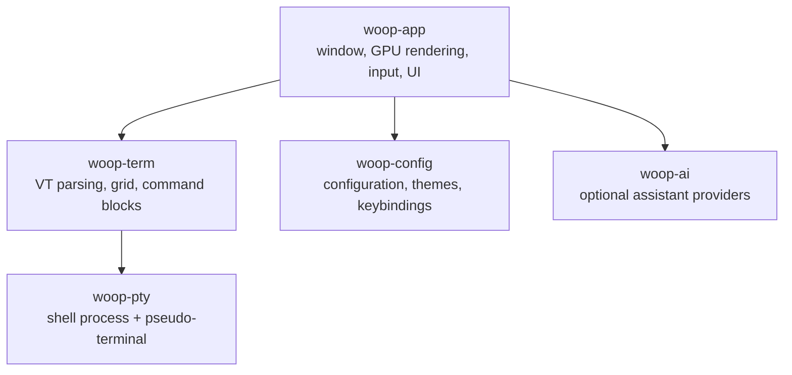

# Architecture

Woop is a Cargo workspace split into small crates with clear responsibilities. The terminal engine has no dependency on the user interface, so it can be tested in isolation.

## Data flow

1. **`woop-pty`** spawns the user's shell attached to a pseudo-terminal (ConPTY on Windows, the native PTY interface on Unix) and exposes byte streams for reading output and writing input.
2. **`woop-term`** parses the output stream (VT/ANSI escape sequences) and updates the screen grid and scrollback. Shell integration markers split the stream into **command blocks**: prompt, command, output and exit status.
3. **`woop-app`** renders the grid and blocks on the GPU, translates keyboard and mouse events into input for the shell, and hosts the interface: tabs, splits, the command palette and the editor-like input.
4. **`woop-config`** loads configuration, themes and keybindings from TOML and notifies the app of changes.
5. **`woop-ai`** provides optional assistant features through a common provider interface. It is inactive unless the user configures a provider.

## Core types

| Type | Crate | Role |
| --- | --- | --- |
| `Pty` | `woop-pty` | Owns the pseudo-terminal and the child process: input, resize, exit status |
| `Terminal` | `woop-term` | Pure emulation state: feed it bytes, read the screen. No I/O, fully unit-testable |
| `Session` | `woop-term` | Connects a `Pty` to a `Terminal`, reads output on a background thread and answers terminal queries |

## Threading model

PTY reading runs on a dedicated thread per session, so slow rendering never blocks the shell and a busy shell never blocks the UI. The reader thread forwards raw output over a channel; the owner of the `Session` applies it to the `Terminal` with `Session::pump`. The UI will coalesce updates and redraw at most once per frame.

## Shell integration

Command blocks rely on the shell emitting OSC 133 semantic prompt markers around the prompt, the command and its output. Woop will ship integration scripts for PowerShell, bash, zsh and fish. Without integration, Woop behaves as a standard terminal.

## Key dependencies

| Area | Choice | Reason |
| --- | --- | --- |
| UI and rendering | [iced](https://iced.rs) | GPU-accelerated through wgpu, cross-platform, Elm-style architecture |
| Terminal emulation | [alacritty_terminal](https://crates.io/crates/alacritty_terminal) | Mature, well-tested VT parser, screen grid and scrollback |
| Pseudo-terminal | [portable-pty](https://crates.io/crates/portable-pty) | Unified API over ConPTY and Unix PTYs |
| Configuration | [serde](https://serde.rs) + [toml](https://crates.io/crates/toml) | Human-readable configuration |
