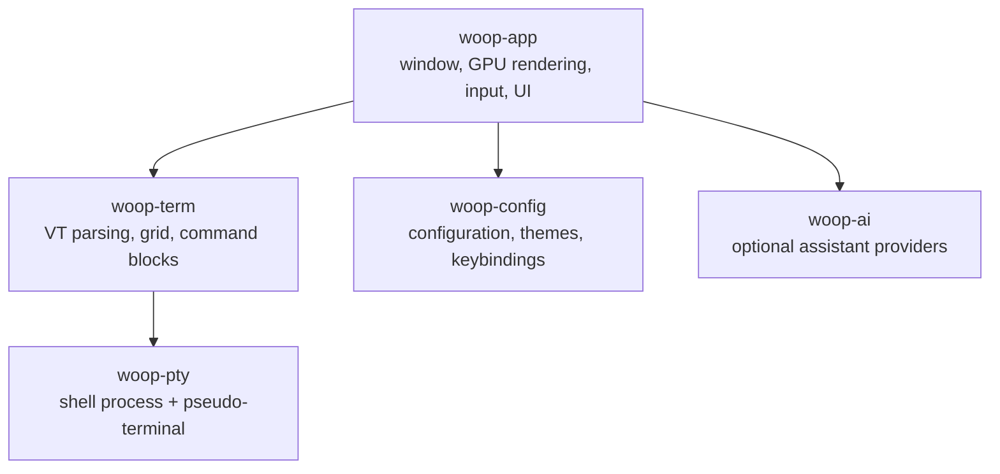

# Architecture

Woop is a Cargo workspace split into small crates with clear responsibilities. The terminal engine has no dependency on the user interface, so it can be tested in isolation.

## Data flow

1. **`woop-pty`** spawns the user's shell attached to a pseudo-terminal (ConPTY on Windows, the native PTY interface on Unix) and exposes byte streams for reading output and writing input.
2. **`woop-term`** parses the output stream (VT/ANSI escape sequences) and updates the screen grid and scrollback. Shell integration markers split the stream into **command blocks**: prompt, command, output and exit status.
3. **`woop-app`** renders the grid and blocks on the GPU, translates keyboard and mouse events into input for the shell, and hosts the interface: tabs, splits, the command palette and the editor-like input.
4. **`woop-config`** loads configuration, themes and keybindings from TOML and notifies the app of changes.
5. **`woop-ai`** provides optional assistant features through a common provider interface. It is inactive unless the user configures a provider.

## Core types

| Type | Crate | Role |
| --- | --- | --- |
| `Pty` | `woop-pty` | Owns the pseudo-terminal and the child process: input, resize, exit status |
| `Terminal` | `woop-term` | Pure emulation state: feed it bytes, read the screen. No I/O, fully unit-testable |
| `Session` | `woop-term` | Connects a `Pty` to a `Terminal`, reads output on a background thread and answers terminal queries |
| `Block` | `woop-term` | One command from the shell integration: command text, exit code, duration and position in the scrollback |
| `Screen` | `woop-term` | Snapshot of the visible cells, colours and cursor in Woop's own types, ready to draw |
| `input` | `woop-term` | Encodes key presses and pasted text into the bytes applications expect |
| `TerminalView` | `woop-app` | iced canvas program that draws a `Screen` and turns window events into messages |

## Threading model

PTY reading runs on a dedicated thread per session, so slow rendering never blocks the shell and a busy shell never blocks the UI. The reader thread forwards raw output over a bounded queue (at most 1 MiB; when it is full the process blocks on its writes) and notifies the application, at most once until the next `Session::pump` ([ADR 0010](adr/0010-screen-snapshots-and-wakeups.md)). The application then pumps, which applies a bounded amount of output and asks to be woken again if more is waiting, takes a `Screen` snapshot and redraws ([ADR 0013](adr/0013-bound-the-cost-of-program-output.md)). Input goes the other way through a second thread per session: keys, paste and replies to terminal queries are queued (at most 16 MiB) and written by the writer thread, so a process that stops reading its input never blocks the UI ([ADR 0015](adr/0015-write-input-on-a-dedicated-thread.md)). When the shell is idle, Woop does no work.

## Shell integration

Command blocks rely on the shell emitting OSC 133 semantic prompt marks around the prompt, the command and its output. Woop ships integration scripts for PowerShell, bash, zsh and fish in `crates/woop-term/shell/` and loads them automatically after the user's own configuration (`woop_term::shell_integration`). `woop-term` reads the marks from the output stream and keeps a list of `Block`s, whose positions are anchored to logical lines so they survive resizing ([ADR 0011](adr/0011-shell-integration-and-command-blocks.md)). Shells without integration work as in any terminal, without blocks.

## Key dependencies

| Area | Choice | Reason |
| --- | --- | --- |
| UI and rendering | [iced](https://iced.rs) | GPU-accelerated through wgpu, cross-platform, Elm-style architecture |
| Terminal emulation | [alacritty_terminal](https://crates.io/crates/alacritty_terminal) | Mature, well-tested VT parser, screen grid and scrollback |
| Pseudo-terminal | [portable-pty](https://crates.io/crates/portable-pty) | Unified API over ConPTY and Unix PTYs |
| Configuration | [serde](https://serde.rs) + [toml](https://crates.io/crates/toml) | Human-readable configuration |
